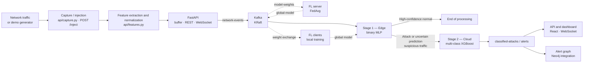

# NIDS-FL — Network Intrusion Detection with Federated Learning

NIDS-FL is a research and demonstration project that combines network intrusion detection, machine learning, and federated learning. It provides a two-stage classification pipeline, Kafka-based event streaming, a monitoring API, and a web dashboard.

The repository also includes exploration and training notebooks, pre-trained model artifacts, and traffic simulation tools. The pipeline can be demonstrated with injected traffic, without access to a network interface in capture mode.

> **Status:** experimental prototype. Results on CICIDS2017 do not guarantee the same performance on a real network. Evaluate the system with your own data and environment before operational use.

## Contents

- [Features](#features)
- [Architecture](#architecture)
- [Detection stages](#detection-stages)
- [Technology stack](#technology-stack)
- [Repository structure](#repository-structure)
- [Prerequisites](#prerequisites)
- [Installation and startup](#installation-and-startup)
- [API and interfaces](#api-and-interfaces)
- [Data and models](#data-and-models)
- [Configuration](#configuration)
- [Additional documentation](#additional-documentation)
- [Limitations and security](#limitations-and-security)

## Features

| Area | Feature |
|---|---|
| Detection | Binary classification at the edge, followed by multi-class classification in the cloud |
| Transport | Kafka in KRaft mode for network events, results, and federated learning exchanges |
| Federated learning | Local training by clients and FedAvg aggregation without centralizing their training data |
| API | FastAPI for inference, traffic injection, alerts, and pipeline status |
| Monitoring | React/Vite dashboard, WebSocket stream, Kafka UI, and orchestrator metrics |
| Visualization | Alert graph representation through the Neo4j integration |
| Experimentation | Notebooks, recorded metrics, traffic simulation scripts, and unit tests |

## Architecture

Real-time inference and federated training are separate processes. Models produced or refined through federated learning can be used by the binary edge detector.



### Packet processing flow

1. A packet is captured on a Linux interface, or submitted to the API through `POST /inject`.
2. Network fields and flow statistics are normalized into a feature vector.
3. Kafka distributes the event on the `network-events` topic.
4. The edge detector uses a binary MLP to decide whether traffic can be dropped or needs further analysis.
5. Suspicious or uncertain traffic is sent to the cloud analyzer, which predicts an attack class with XGBoost.
6. Classifications and alerts are exposed through the API, dashboard, and graph integration.

### Federated learning

Each client trains the binary model locally on its partition, then publishes its weights. The server aggregates the weights with FedAvg and broadcasts the global model. Raw training examples remain with the clients; model weights and metrics are exchanged through Kafka.

## Detection stages

| Stage | Component | Role |
|---|---|---|
| Capture | `api/capture.py` | Listens for IPv4 TCP, UDP, and ICMP packets on a Linux interface |
| Features | `api/features.py` | Extracts packet fields and derives statistics used for inference |
| Pipeline input | API / `network-events` topic | Receives captured or injected traffic |
| Edge screening | `hybrid/edge_detector.py` | Binary MLP; drops sufficiently confident normal traffic and forwards the rest |
| Cloud classification | `hybrid/cloud_analyzer.py` | Multi-class XGBoost; enriches and publishes results and alerts |
| Federated training | `federated_learning/` | Trains clients and aggregates models with FedAvg |
| Presentation | `dashboard/` and API | Displays packets, results, metrics, and alerts |

## Technology stack

| Layer | Technologies |
|---|---|
| API and capture | Python, FastAPI, Uvicorn, WebSocket, Linux sockets |
| Streaming | Apache Kafka 4.1 in KRaft mode, Kafbat Kafka UI |
| Machine learning | TensorFlow/Keras, XGBoost, scikit-learn, Optuna |
| Federated learning | MLP and FedAvg aggregation over Kafka |
| Graph | Neo4j 5, Python driver |
| Dashboard | React, TypeScript, Vite, Plotly |
| Containerization | Docker Compose |
| Experimental data | CICIDS2017 preprocessed dataset |

## Repository structure

| Directory / file | Contents |
|---|---|
| `api/` | FastAPI service, network capture, feature extraction, and WebSocket stream |
| `hybrid/` | Edge detector, cloud analyzer, and metrics collection |
| `federated_learning/` | MLP model, clients, server, preprocessing, and FedAvg aggregation |
| `kafka_pipeline/` | Kafka producer and connection check |
| `infra/docker-compose.yml` | Kafka, Kafka UI, and Neo4j |
| `dashboard/` | React/TypeScript web application |
| `models/final/` | Model artifacts and selection manifest |
| `data/` | Dataset information and recorded metrics |
| `notebooks/` | Data exploration, model training, and comparisons |
| `attacks/` | Traffic simulation and demo scenarios |
| `scripts/` | Start/stop, traffic generation, and data preparation |
| `tests/` | Unit tests for features, models, and Kafka connectivity |
| `docs/` | Installation, architecture, API, and configuration guides |
| `SYSTEM_FLOW.md` | Detailed description of the system flow |

## Prerequisites

- Linux or WSL2 for network capture and shell scripts.
- Python 3.11 or a version compatible with the pinned dependencies.
- Docker with the Docker Compose plugin.
- Node.js and npm for the dashboard.
- Appropriate permissions for packet capture (`CAP_NET_RAW` or equivalent privileges).

Network capture is optional for a demo: the traffic generator can inject events over HTTP.

## Installation and startup

The commands below are intended for Linux or WSL2, run from the repository root.

### 1. Start the infrastructure

```bash
docker compose -f infra/docker-compose.yml up -d
docker compose -f infra/docker-compose.yml ps
```

### 2. Install Python dependencies

```bash
python3 -m venv venv
source venv/bin/activate
python -m pip install --upgrade pip
pip install -r requirements.txt
cp .env.example .env
```

From WSL2 or the host, the external Kafka listener in the Compose file is usually available at `localhost:29092`. Port `9092` is for communication inside the Docker network. Check `KAFKA_BROKER` in your configuration before starting the services.

### 3. Start the detection pipeline

```bash
./scripts/start_pipeline.sh
```

This script starts the API, edge detector, and cloud analyzer. The startup scripts expect a virtual environment at `./venv`.

To adjust the confidence threshold and batch size:

```bash
./scripts/start_pipeline.sh --threshold 0.95 --batch-size 32 --broker localhost:29092 --port 8000
```

### 4. Inject demo traffic

In another terminal:

```bash
source venv/bin/activate
python scripts/traffic_gen.py --direct --attack-type mixed --duration 60
```

The `--direct` option sends test traffic to `POST /inject` and avoids the need for network capture permissions.

### 5. Start the dashboard

```bash
cd dashboard
npm install
npm run dev
```

The dashboard is usually available at [http://localhost:5173](http://localhost:5173). The API is available at [http://localhost:8000](http://localhost:8000).

### 6. Run federated training (optional)

Federated training is independent of the inference pipeline. Run the following from the repository root:

```bash
./scripts/start_all.sh --rounds 10 --epochs 5
```

The script starts one server and three clients. To launch components separately:

```bash
python -m federated_learning.fl_server --rounds 10 --clients 3
python -m federated_learning.fl_client --id 1 --rounds 10 --epochs 5
```

Launch clients 2 and 3 in the same way, using `--id 2` and `--id 3`. See the federated learning documentation for data and model artifact requirements.

### Stop the services

```bash
./scripts/stop_pipeline.sh
./scripts/stop_all.sh
docker compose -f infra/docker-compose.yml down
```

## API and interfaces

| Service | Default address | Purpose |
|---|---|---|
| Dashboard | `http://localhost:5173` | Visual monitoring |
| API and Swagger UI | `http://localhost:8000/docs` | Interactive API documentation |
| API ReDoc | `http://localhost:8000/redoc` | Alternative API reference |
| Kafka UI | `http://localhost:8081` | Inspect Kafka topics |
| Neo4j Browser | `http://localhost:7474` | Explore the graph |
| Prometheus metrics | `http://localhost:9200/metrics` | Available when the orchestrator is running |

Main endpoints:

| Method / route | Description |
|---|---|
| `POST /predict` | Run inference on a JSON event |
| `POST /inject` | Publish an event to the Kafka pipeline |
| `GET /predictions` | Recent results, with filters |
| `GET /alerts` | Recent attack alerts |
| `GET /packets` and `GET /stats` | Available packets and aggregates |
| `GET /pipeline/status` and `GET /health` | API and model status |
| `GET /models`, `GET /fl/history` | Model registry and FL history |
| `GET /hybrid/metrics`, `GET /graph/attacks` | Hybrid metrics and graph data |
| `WS /stream` | Real-time events for the dashboard |

## Data and models

The project uses a cleaned and preprocessed version of CICIDS2017. The model manifest describes 11 selected features and 7 attack/benign classes.

| Registered model | Use | Result recorded in the manifest |
|---|---|---|
| Multi-class XGBoost | 7-class cloud analysis | Accuracy: 0.9944; macro F1: 0.8620 |
| Binary MLP | Edge screening and FL initialization | Accuracy: 0.9938; macro F1: 0.9889 |
| Random Forest | Baseline model | Accuracy: 0.9943; macro F1: 0.8627 |

These values were measured on the test data described in the manifest; they are not a production guarantee. The classes are imbalanced, and F1 varies substantially by class (especially for *Web Attacks*). Accuracy alone is therefore insufficient to evaluate the detector.

The full dataset and some auxiliary artifacts may need to be prepared locally. To train models or retrieve the dataset, see `scripts/setup_dataset.sh`, the notebooks, and [docs/models.md](docs/models.md). Inference requires the model, scaler, and label encoder files expected by the code; check that they are present in your checkout before starting the service.

## Configuration

Base configuration is documented in `.env.example` and `docs/configuration.md`. The main variables cover:

| Variable | Purpose |
|---|---|
| `KAFKA_BROKER` | Kafka broker address |
| `CAPTURE_IFACE` | Network interface to capture from |
| `NEO4J_URI`, `NEO4J_USER`, `NEO4J_PASSWORD` | Neo4j connection |
| `API_HOST`, `API_PORT` | API address and port |
| `FL_NUM_CLIENTS`, `FL_NUM_ROUNDS`, `FL_LOCAL_EPOCHS` | Federated training parameters |

Scripts and services also accept CLI options; see [docs/configuration.md](docs/configuration.md).

## Additional documentation

- [Installation guide](docs/setup.md)
- [Detailed architecture (French)](docs/architecture.fr.md)
- [Detailed architecture (English)](docs/architecture.md)
- [API reference](docs/api-reference.md)
- [Configuration](docs/configuration.md)
- [Federated learning](docs/federated-learning.md)
- [Models and results](docs/models.md)
- [Troubleshooting](docs/troubleshooting.md)
- [Development](docs/development.md)
- [Project report](rapport_nids_fl.md)

## Limitations and security

- This repository is intended for experimentation and demonstration; it does not by itself provide the guarantees of a production NIDS.
- Packet capture requires a suitable Linux environment and corresponding system permissions.
- Live traffic features are derived from packets and flow windows; they may differ from the CICIDS2017 flow features used for training. Validate results beyond the test dataset.
- The Compose configuration exposes demo Neo4j credentials, and the API is configured with open CORS. Change credentials and restrict network exposure before any shared deployment.
- Federated learning shares model weights rather than raw data; this alone does not provide a formal privacy guarantee.

---

NIDS-FL — experimental network intrusion detection repository.
