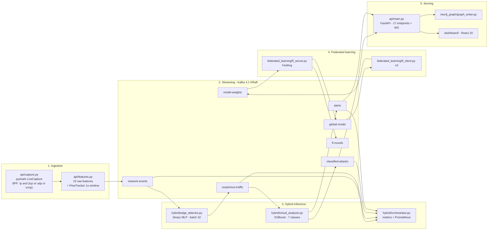

# Architecture

> A French-language version of this document, written earlier in the project, is preserved at
> [`architecture.fr.md`](architecture.fr.md). Where the two disagree, this document reflects the
> current code.

## Design goals

| Goal | How it is met |
|---|---|
| Never centralise raw traffic | Federated learning — clients exchange weight tensors only (~22 KB/round) |
| Keep per-packet cost low | Two-stage inference; confident-benign traffic is dropped at stage 1 |
| Survive component failure | Every stage is a decoupled Kafka consumer; the API falls back to in-process inference when the broker is down |
| Be observable | Prometheus endpoint, ASCII dashboard, atomic metrics file, live WebSocket feed |

## Component map



## Stage 1 — Capture and feature extraction

`api/capture.py` wraps `pyshark.LiveCapture` as an async generator. The BPF filter
`ip and (tcp or udp or icmp)` is applied at the capture layer so non-IP frames never reach Python.

`api/features.py` turns each packet into **23 raw features** (`FEATURE_KEYS`): packet-level fields
(protocol, addresses, ports, TTL, six TCP flags, window size, ICMP type/code, payload length) plus
four pseudo-flow features maintained by a `FlowTracker` over a **rolling 1-second window keyed by
source IP**: `packet_count_1s`, `bytes_per_sec_1s`, `avg_packet_size_1s`, `packet_freq_1s`.

Those are then mapped onto the **11 CICIDS2017 column names** the models were trained against
(`ML_FEATURE_KEYS`):

| CICIDS2017 column | Derived from |
|---|---|
| `Destination Port` | `dst_port` |
| `FIN Flag Count` | `fin_flag` |
| `PSH Flag Count` | `psh_flag` |
| `ACK Flag Count` | `ack_flag` |
| `Init_Win_bytes_forward` | `window_size` |
| `Subflow Fwd Bytes` | `payload_length` |
| `Total Fwd Packets` | `packet_count_1s` |
| `Flow Bytes/s` | `bytes_per_sec_1s` |
| `Average Packet Size` | `avg_packet_size_1s` (rolling — more accurate than per-packet) |
| `Flow Packets/s` | `packet_freq_1s` |
| `Fwd Packets/s` | `packet_freq_1s` (same value fills two CICIDS columns) |

This mapping is the seam between live capture and offline-trained models, and it is the first
place to look when live accuracy diverges from notebook accuracy.

## Stage 2 — Edge detector

`hybrid/edge_detector.py` consumes `network-events` and runs the **federated binary MLP**
(11 → 256 → 128 → 64 → 32 → 1). Inference is **batched** (default 32) to amortise Keras call
overhead rather than predicting per packet.

Routing, gated on a confidence threshold (default `0.95`):

```
confidence >= threshold  AND  class = Attack   -> forward to suspicious-traffic
confidence >= threshold  AND  class = Normal   -> DROP (never reaches stage 2)
confidence <  threshold  (uncertain)           -> forward to suspicious-traffic
```

Only the confident-benign branch terminates. Everything else is escalated, so the design is
deliberately biased toward recall at the edge: a mistake by the small model costs one extra
XGBoost inference, not a missed attack.

## Stage 3 — Cloud analyzer

`hybrid/cloud_analyzer.py` consumes `suspicious-traffic` and runs the **XGBoost Optuna champion**
over 7 classes. For each packet it decodes the features and the edge metadata, rescales with the
shared `FeatureScaler`, classifies, and enriches the record with full pipeline provenance
(both stages' verdicts, confidences, and latencies).

Output routing:

- → `classified-attacks` — **always**, giving a complete audit trail including the edge's false positives
- → `alerts` — **only** when `attack_type != "Normal Traffic"`

Severity is assigned by `compute_severity()`:

| Rule (evaluated in order) | Severity |
|---|---|
| DDoS / DoS / Bots with confidence ≥ 0.65 | `high` |
| any attack with confidence ≥ 0.90 | `high` |
| Brute Force / Web Attacks / Port Scanning with confidence ≥ 0.55 | `medium` |
| any attack with confidence ≥ 0.65 | `medium` |
| confirmed attack below the above | `low` |
| `Normal Traffic` (edge false positive) | `none` — never alerted |

## Stage 4 — Federated learning

Covered in detail in [federated-learning.md](federated-learning.md). In short: three clients each
train the binary MLP on a local partition, publish serialised weights to `model-weights`, and the
server aggregates them with FedAvg, evaluates the global model on a held-out test set, and
broadcasts the result on `global-model`. Round metrics are published to `fl-rounds` and persisted
to `data/fl_history.json`.

## Stage 5 — API and dashboard

`api/main.py` is the single serving surface. Beyond the REST endpoints it runs two background
loops started in the FastAPI `lifespan` handler:

- **`kafka_monitor_loop`** — consumes `classified-attacks` and `alerts`, maintains the in-memory
  `KafkaDashboardState`, persists alerts, and pushes updates to WebSocket clients
- **`capture_loop`** — drives live packet capture when enabled

State is held in bounded in-memory buffers (`BUFFER` for raw packets, `PREDICTIONS` for classified
packets, `ALERTS` for confirmed attacks), which is why `/packets`, `/predictions` and `/alerts`
are windowed rather than historical.

The **dashboard** (React 19 + TypeScript + Vite + Tailwind + shadcn/ui) has 8 routes:

| Route | Page | Shows |
|---|---|---|
| `/` | Overview | KPIs, live counters, recent alerts |
| `/live` | LiveTraffic | Raw packet feed |
| `/hybrid` | HybridPipeline | Stage-by-stage flow and drop rate |
| `/federated` | FederatedLearning | Round history, per-client metrics |
| `/threats` | ThreatDetection | Alert triage and detail |
| `/graph` | AttackGraph | Force-directed attacker/victim topology |
| `/continual` | ContinualLearning | Retraining view |
| `/models` | ModelsMetrics | Registered models and their metrics |

The client (`dashboard/src/lib/api.ts`) targets `http://localhost:8000` and
`ws://localhost:8000/stream` by default, overridable with `VITE_API_URL` / `VITE_WS_URL`. Several
calls carry a bundled fallback constant (for example `FL_HISTORY_FALLBACK`) so the UI still renders
when the API is down — useful for demos, but worth knowing when a chart looks suspiciously healthy.

## Kafka topics

| Topic | Producer | Consumer | Payload |
|---|---|---|---|
| `network-events` | capture / `POST /inject` / `kafka_pipeline/producer.py` | edge_detector, orchestrator | 11 ML features + routing context |
| `suspicious-traffic` | edge_detector | cloud_analyzer, orchestrator | features + edge verdict |
| `classified-attacks` | cloud_analyzer | API, orchestrator | full enriched record (audit trail) |
| `alerts` | cloud_analyzer | API, orchestrator | confirmed attacks only |
| `model-weights` | fl_client ×3 | fl_server | serialised weight tensors |
| `global-model` | fl_server | fl_client ×3 | aggregated global weights |
| `fl-rounds` | fl_server | dashboards | per-round metrics |

Kafka runs in **KRaft mode** (no ZooKeeper) with 3 default partitions — one per FL client.
Two listeners are exposed: `kafka:9092` for inter-container traffic and `localhost:29092` for
Python clients on the host/WSL2 side. Using the wrong one is the single most common setup error;
see [troubleshooting.md](troubleshooting.md).

## Observability

`hybrid/orchestrator.py` joins all four traffic topics under one consumer group
(`nids_orchestrator`, `auto_offset_reset=latest`) and derives `packets_total`,
`packets_forwarded_to_cloud`, `attacks_confirmed`, `alerts_published`, latency percentiles over a
10,000-sample rolling window, and the attack-type distribution. It writes
`data/hybrid_metrics.json` every 10 s using an **atomic rename**, so readers never observe a
partial file, and serves Prometheus-format metrics from stdlib `http.server` (disable with
`--no-prometheus`).
