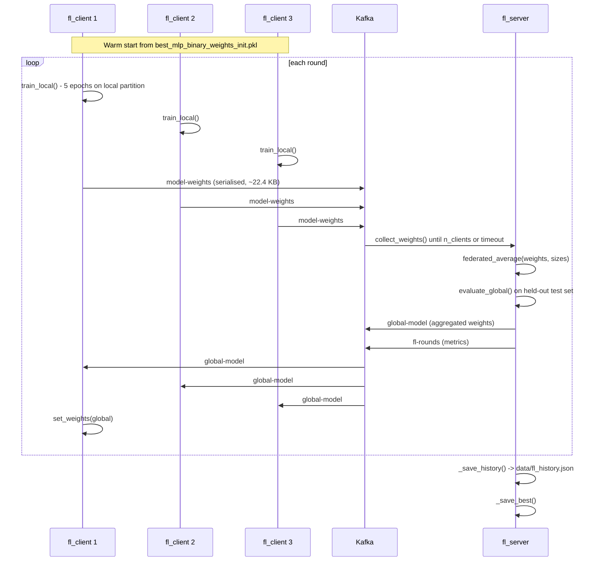

# Federated learning

Implementation of **FedAvg** (McMahan et al., 2017) over Kafka, training the binary
attack/normal MLP without any client sharing raw traffic.

## Why federated here

The binary MLP is the model that runs at the edge on every packet. In a realistic deployment each
site sees different traffic and cannot legally or practically ship raw captures to a central
trainer. FedAvg lets each site train locally and contribute only weights — about **22.4 KB per
client per round**, against gigabytes of raw traffic.

## Round protocol



Server-side, each round is exactly the five steps documented at the top of
[`fl_server.py`](../federated_learning/fl_server.py):

1. Collect weight messages from `n_clients` on `model-weights`
2. Aggregate with `federated_average`
3. Evaluate the global model on the held-out test set
4. Broadcast on `global-model`
5. Log metrics and persist history

## Aggregation

`federated_average()` in [`aggregation.py`](../federated_learning/aggregation.py) computes the
sample-weighted mean:

$$w_{global} = \sum_k \frac{n_k}{N} \cdot w_k$$

where `n_k` is client *k*'s local training-set size and `N = Σ n_k`. Clients holding more data pull
the global model proportionally harder.

Implementation details that matter:

- **Accumulation in float64, storage in float32.** Summing many float32 tensors accumulates rounding
  error; the function accumulates in float64 and casts back once at the end.
- **Strict architecture validation.** Before averaging, it verifies every client reports the same
  layer count and identical per-layer shapes, raising `ValueError` on any mismatch. A client running
  a stale architecture fails loudly rather than silently corrupting the global model.
- **`min_clients` gate** (default 2) — aggregation refuses to proceed with too few contributors.

Supporting helpers in the same module:

| Function | Purpose |
|---|---|
| `serialize_weights` / `deserialize_weights` | Wire format for Kafka transport, optional compression |
| `compute_weight_delta` | Magnitude of change between rounds — convergence signal |
| `get_model_fingerprint` | Short hash of a weight list, used to confirm client and server agree |
| `weights_size_kb` / `serialize_size_kb` | Communication-cost accounting |
| `load_initial_weights` | Warm start from the centralised binary MLP |

## The model

Built by `build_mlp()` in [`model.py`](../federated_learning/model.py). The federated configuration
is `FL_INPUT_DIM = 11`, `FL_HIDDEN = (256, 128, 64, 32)`:

```
Input(11)
Dense(256, relu, L2) -> BatchNorm -> Dropout(0.3)
Dense(128, relu, L2) -> BatchNorm -> Dropout(0.3)
Dense(64,  relu, L2) -> BatchNorm -> Dropout(0.3)
Dense(32,  relu, L2) -> [BatchNorm if all_batchnorm] -> Dropout(0.2)
Dense(1, sigmoid)                     loss = binary_crossentropy, Adam
```

The last hidden layer normally has **no** BatchNorm. To warm-start from the centralised binary MLP
you must pass `all_batchnorm=True` so the layer stack matches the saved weights exactly — that flag
exists precisely for this compatibility, and getting it wrong produces a shape mismatch at load.

## Warm start

Both server and client initialise from
`models/final/best_mlp_binary_weights_init.pkl` — the weights of the centralised binary champion
(F1 macro 0.9889). Federated training therefore starts from a strong model and refines it, rather
than training from scratch, which is why round 1 already reports a global F1 of ~0.88.

## Client behaviour

[`fl_client.py`](../federated_learning/fl_client.py):

| Method | Role |
|---|---|
| `load_local_data()` | Load this client's partition |
| `_partition_from_train()` | Derive a disjoint slice from the training set when no dedicated partition exists |
| `train_local()` | Local training (default 5 epochs) |
| `evaluate_local()` | Local metrics reported alongside the weights |
| `send_weights(round_idx)` | Serialise and publish to `model-weights` |
| `receive_global_model(round_idx, timeout=60)` | Block for the aggregated model, apply it |
| `run(repeat_hours)` | Full round loop, optionally repeating on a schedule |

Clients are launched with `--id 1|2|3`, and partitions differ in size — the recorded run has 3000,
2800 and 3200 samples, which is what makes the FedAvg weighting non-uniform.

## Recorded results

From [`data/fl_history.json`](../data/fl_history.json) — 10 rounds, 3 clients, FedAvg:

| Round | Global F1 | Global accuracy | Global loss |
|---|---|---|---|
| 1 | 0.8816 | 0.8930 | 0.2977 |
| 2 | 0.8843 | 0.8935 | 0.2496 |
| … | … | … | … |

Each round record also carries per-client `local_f1`, `local_accuracy`, `n_samples` and
`weights_size_kb` (22.4 KB throughout), plus `aggregation_method` and a timestamp. The dashboard's
**Federated Learning** page plots this file, served through `GET /fl/history`.

## Running

```bash
# Full stack: 1 server + 3 clients
./scripts/start_all.sh
./scripts/start_all.sh --rounds 20 --epochs 10
./scripts/start_all.sh --daily          # continuous, re-runs every 24 h

# Or individually
python -m federated_learning.fl_server --rounds 10 --clients 3 --timeout 120
python -m federated_learning.fl_client --id 1 --rounds 10 --epochs 5
```

Server flags: `--rounds`, `--clients`, `--broker`, `--timeout` (seconds to wait for all clients in a
round), `--repeat-hours`. Client flags: `--id`, `--rounds`, `--epochs`, `--broker`,
`--repeat-hours`.

## Connecting FL to the live pipeline

The aggregated binary MLP is the model `hybrid/edge_detector.py` loads for stage-1 screening. So the
federated training loop and the inference pipeline meet at exactly one artefact: the binary MLP
weights. The 7-class XGBoost model used in stage 2 is trained centrally and is **not** part of the
federated process.
